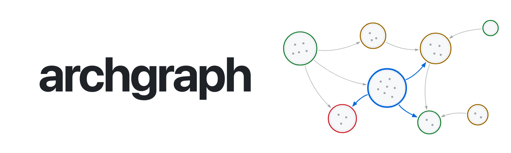

<p align="center">
  <picture>
    <source media="(prefers-color-scheme: dark)" srcset="docs/assets/banner-dark.png">
    
  </picture>
</p>

<p align="center">
  An architecture linter for your codebase.<br>
  It finds the folders that import each other, names the import that breaks each loop,<br>
  and simulates a suggested file move before you make it.<br>
  <sub>Reads TypeScript, JavaScript and Python today. Go, Rust and Java/Kotlin are next.</sub>
</p>

<p align="center">
  <a href="https://github.com/dogebonker/archgraph/actions/workflows/ci.yml"></a>
  <a href="https://github.com/dogebonker/archgraph/releases"></a>
  <a href="#license"></a>
</p>

<a href="https://dogebonker.github.io/archgraph/next.js.html">
  
</a>
<p align="center"><sub>Next.js (<code>packages/next</code> at <code>00c4ba8</code>): 1,542 files, 85 modules, 6,058 imports. Click it for the live map. Made with <code>archgraph report</code> (<a href="showcase/">how</a>).</sub></p>

archgraph reads every file import in a repository, groups files into modules by folder, and finds the modules that depend on each other in both directions. Folders tied together like that can't be changed, tested or split off alone. archgraph shows where it happened and which few imports to remove first, with the counts behind each suggestion.

## Try it

```bash
curl --proto '=https' --tlsv1.2 -fsSL https://raw.githubusercontent.com/dogebonker/archgraph/main/install.sh | sh
archgraph report path/to/your/repo
```

That prints a summary and writes `.archgraph/archgraph.html`: open it in a browser. The installer checks the release's SHA-256 before it installs anything.

> [!WARNING]
> For TypeScript, `scan` runs the repository's own dependency-cruiser through npx, so the repository decides what runs. Scan code you trust, or scan inside a sandbox.

<details>
<summary>Other ways to install, and what each language needs</summary>

- `npx archgraph-cli report path/to/repo` downloads the same binary and verifies it.
- `cargo install --git https://github.com/dogebonker/archgraph --locked` builds it from source.
- TypeScript and JavaScript: dependency-cruiser 18.4.0 and typescript 6.0.3, in the scanned repository or anywhere (`--depcruise <path>`).
- Python: any Python 3.10+ with grimp 3.17 (`--python <interpreter>`).

</details>

## What it tells you

### Which import to cut

In [outline](https://github.com/outline/outline), `app/editor` imports `app/components` 54 times, and `app/components` imports the editor once: `Lightbox.tsx` reaches into `EditorContext`. Only the editor ever renders the lightbox. Move it into the editor and the two modules stop depending on each other. archgraph finds pairs like this in every import cycle and lists the lightest side first, so the first fix is usually one import, not a refactor.

### Which file move untangles the most

Some cycles hang on a single wiring file. In [typeorm](https://github.com/typeorm/typeorm), `DriverFactory.ts` imports all eleven database drivers from inside the folder they live in. archgraph simulates moving it into a folder of its own before suggesting it:

```console
$ archgraph report packages/typeorm/src
Graph
  496 files, 70 modules, 2586 imports

Cycles
  3 module cycles, largest 27 modules
  move driver/DriverFactory.ts to driver/driver-factory/DriverFactory.ts: removes 10 two-way pairs; the cycle drops from 27 to 5 modules; no new cycle
```

### Whether imports follow your layout

Write down the architecture you agreed on, and every import gets a verdict:

```yaml
# layout.yaml
version: 1
layers: ["src/domain/**", "src/application/**", "src/adapters/**", "src/main.ts"]
forbid:
  - { id: in-no-out, from: "src/adapters/in/**", to: "src/adapters/out/**" }
  - { id: out-no-in, from: "src/adapters/out/**", to: "src/adapters/in/**" }
```

```console
$ archgraph scan . --rules layout.yaml -o graph.json
$ archgraph check graph.json
forbidden src/adapters/in/http.ts -> src/adapters/out/pg.ts (in-no-out)
forbidden src/adapters/out/queue.ts -> src/adapters/in/cli.ts (out-no-in)
forbidden src/domain/user.ts -> src/adapters/out/pg.ts (layers)
3 forbidden, 0 unplanned
```

<p align="center">
  
</p>

The map is one HTML file with no network requests. Zoom until files appear, drag modules to make sense of a cluster (your layout is remembered), click anything for who imports it and what to do about it.

## Results on 20 well-known repositories

archgraph on 20 open-source projects at pinned commits. Each name opens its live map; the path under a name is the folder that was scanned.

| Project | Files | Largest cycle | First suggested step |
|---|--:|--:|---|
| [vercel/next.js](https://dogebonker.github.io/archgraph/next.js.html)<br><sub><code>packages/next</code></sub> | 1,542 | 62 modules | cut <code>shared/lib → server/app-render</code><br><sub>in <code>preload-chunks.tsx</code></sub> |
| [nestjs/nest](https://dogebonker.github.io/archgraph/nest.html) | 666 | 16 modules | cut <code>packages/core/inspector → packages/core</code><br><sub>in <code>serialized-graph.ts</code></sub> |
| [django/django](https://dogebonker.github.io/archgraph/django.html) | 713 | 31 modules | cut <code>utils → forms</code><br><sub>in <code>feedgenerator.py</code></sub> |
| [typeorm/typeorm](https://dogebonker.github.io/archgraph/typeorm.html)<br><sub><code>packages/typeorm/src</code></sub> | 496 | 27 modules | move <code>DriverFactory.ts</code> into its own folder<br><sub>cycle drops from 27 to 5 modules</sub> |
| [outline/outline](https://dogebonker.github.io/archgraph/outline.html) | 2,243 | 40 modules | cut <code>app/components → app/editor</code><br><sub>in <code>Lightbox.tsx</code></sub> |
| [payloadcms/payload](https://dogebonker.github.io/archgraph/payload.html)<br><sub><code>packages/payload</code></sub> | 819 | 21 modules | cut <code>utilities → collections</code><br><sub>in <code>createPayloadRequest.ts</code></sub> |
| [activepieces/activepieces](https://dogebonker.github.io/archgraph/activepieces.html)<br><sub><code>packages/server/api</code></sub> | 757 | 32 modules | cut <code>app/helper → app/ee</code><br><sub>in <code>embed-security.ts</code></sub> |
| [immich-app/immich](https://dogebonker.github.io/archgraph/immich.html)<br><sub><code>server</code></sub> | 458 | 9 modules | cut <code>decorators.ts → schema</code><br><sub>in <code>decorators.ts</code></sub> |
| [excalidraw/excalidraw](https://dogebonker.github.io/archgraph/excalidraw.html)<br><sub><code>packages/excalidraw</code></sub> | 364 | 29 modules | cut <code>actions → components/CommandPalette</code><br><sub>in <code>actionLinearEditor.tsx</code></sub> |
| [strapi/strapi](https://dogebonker.github.io/archgraph/strapi.html)<br><sub><code>packages/core/core/src</code></sub> | 236 | 5 modules | drop one re-export<br><sub><code>getDirs</code> from <code>utils/index.ts</code></sub> |
| [trpc/trpc](https://dogebonker.github.io/archgraph/trpc.html)<br><sub><code>packages/server</code></sub> | 83 | 5 modules | cut <code>unstable-core-do-not-import/error → unstable-core-do-not-import</code><br><sub>in <code>TRPCError.ts</code></sub> |
| [vitejs/vite](https://dogebonker.github.io/archgraph/vite.html)<br><sub><code>packages/vite</code></sub> | 135 | 5 modules | cut <code>node/ssr → node/server</code><br><sub>in <code>fetchModule.ts</code></sub> |
| [zulip/zulip](https://dogebonker.github.io/archgraph/zulip.html) | 733 | 14 modules | cut <code>lib → webhooks</code><br><sub>in <code>integrations.py</code></sub> |
| [sqlalchemy/sqlalchemy](https://dogebonker.github.io/archgraph/sqlalchemy.html)<br><sub><code>lib</code></sub> | 245 | 3 modules | cut <code>sql → engine</code><br><sub>in <code>sqltypes.py</code></sub> |
| [celery/celery](https://dogebonker.github.io/archgraph/celery.html) | 161 | 5 modules | cut <code>app → worker</code><br><sub>in <code>trace.py</code></sub> |
| [scrapy/scrapy](https://dogebonker.github.io/archgraph/scrapy.html) | 194 | 18 modules | cut <code>utils → spiders</code><br><sub>in <code>spider.py</code></sub> |
| [pydantic/pydantic](https://dogebonker.github.io/archgraph/pydantic.html) | 79 | 8 modules | cut <code>errors.py → _internal</code><br><sub>in <code>errors.py</code></sub> |
| [fastapi/fastapi](https://dogebonker.github.io/archgraph/fastapi.html) | 52 | 14 modules | cut <code>telemetry → __init__.py</code><br><sub>in <code>_asgi.py</code></sub> |
| [pallets/flask](https://dogebonker.github.io/archgraph/flask.html) | 21 | none | no module cycles<br><sub>a flat package</sub> |
| [encode/httpx](https://dogebonker.github.io/archgraph/httpx.html) | 23 | none | no module cycles<br><sub>a flat package</sub> |

<sub>Scanned by us at the commits listed in [showcase/repos.json](showcase/repos.json), from shallow clones (so no co-change analysis). These are reading aids for maintainers, not endorsements or ratings. Rebuild them with [`showcase/build.sh`](showcase/).</sub>

## Gate pull requests

```yaml
# .github/workflows/architecture.yml
on: [pull_request]
permissions: { contents: read }
jobs:
  archgraph:
    runs-on: ubuntu-latest
    steps:
      - uses: actions/checkout@3d3c42e5aac5ba805825da76410c181273ba90b1 # v7.0.1
        with: { fetch-depth: 0, persist-credentials: false }
      - uses: actions/setup-node@820762786026740c76f36085b0efc47a31fe5020 # v7.0.0
        with: { node-version: 22 }
      - uses: dogebonker/archgraph@v0.1.0
```

The action scans the pull request and its base commit and fails only on what the pull request adds: a new forbidden import, or a new or grown cycle. Problems already on the base branch do not fail the check. The summary lands in the job:


## For coding agents

Four skills in the open Agent Skills format, for Claude Code, Codex, Cursor and anything else that reads them:

- **[archgraph](skills/archgraph/SKILL.md)** runs the tool and reads its output correctly.
- **[archgraph-guard](skills/archgraph-guard/SKILL.md)** checks a change against its base commit before the agent says it is done, and fixes the violations it introduced. It can run as a Claude Code Stop hook.
- **[archgraph-fix](skills/archgraph-fix/SKILL.md)** fixes one finding end to end and keeps the change only when a re-scan and the tests agree.
- **[archgraph-rules](skills/archgraph-rules/SKILL.md)** writes a `layout.yaml` from the architecture you approve and proves each rule catches a planted violation.

## How it works

archgraph has no parser of its own. It asks [dependency-cruiser](https://github.com/sverweij/dependency-cruiser) (TypeScript, JavaScript) or [grimp](https://github.com/python-grimp/grimp) (Python) for every file-level import, groups files into modules by folder or by your rules, and computes coupling, cohesion, cycles over runtime imports, rule verdicts and findings. For Python it also reads each importing file with the standard `ast` module, without running it, to tell imports inside functions and `TYPE_CHECKING` blocks apart from load-time ones. Everything lands in one JSON document with a versioned schema ([`archgraph/v1`](schema/archgraph.v1.schema.json)) that `check`, `simulate`, `render` and `diff` read. The [guide](docs/guide.md) has every command, flag and rule.

## Limits

- Imports are not semantics. Dependency injection, event buses and string lookups are invisible to it; `--cochange` reads git history for files that change together without importing each other.
- Findings are suggestions with evidence, not a score to optimise. Read the evidence, then decide.
- Module boundaries come from folders or your rules. Wrong boundaries give wrong numbers.
- Small repositories have little signal, and the report says so.
- TypeScript, JavaScript and Python today.

## Free, all of it

No paid tier, no account, no telemetry. What comes next is open source too: Go, Rust and Java/Kotlin collectors, history across repositories, shared rule libraries, team coupling from CODEOWNERS and co-change, and migration plans that sequence simulated moves into a target layout.

## License

MIT or Apache-2.0, at your option. Issues and pull requests are welcome.
