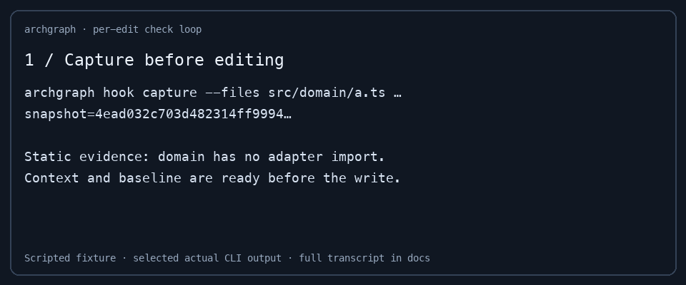
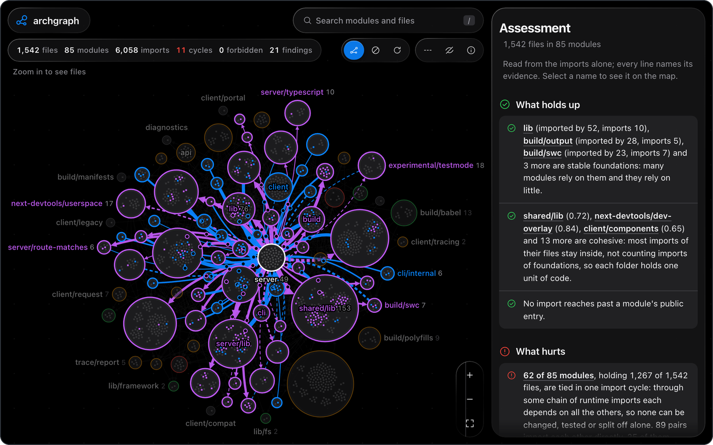
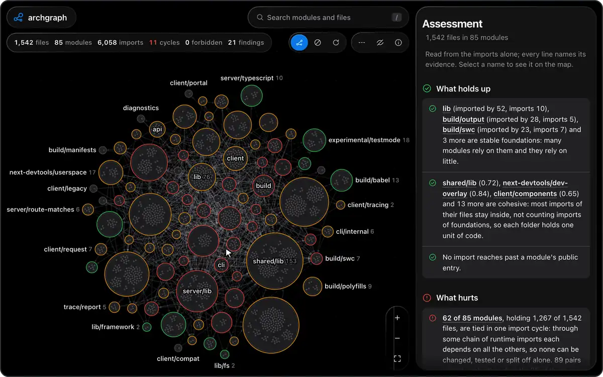
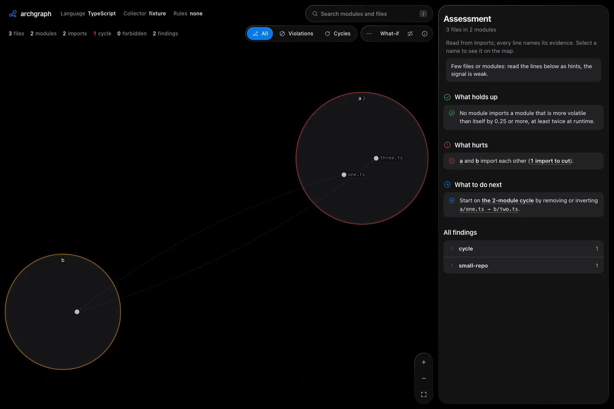
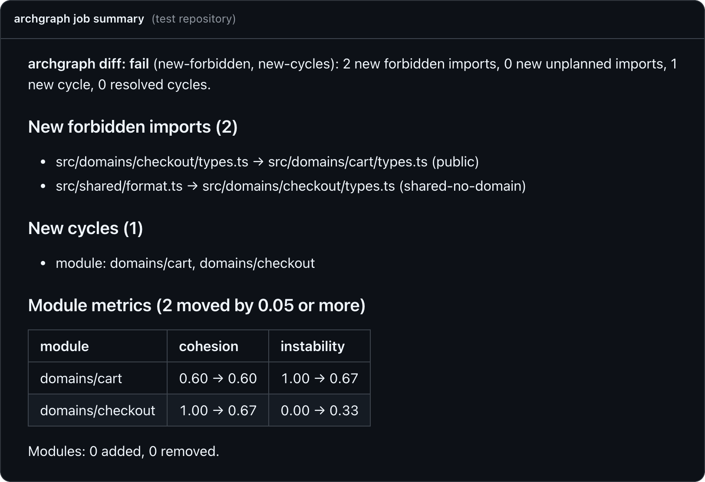

# archgraph: architecture enforcement derived from the import graph

## Install and initialize

```sh
cargo +stable install --git https://github.com/dogebonker/archgraph --locked && archgraph init --preset layered --scope internal
```

Builds current `main` with stable Rust. No architecture docs required: infer a reviewable draft from existing imports, or start with one of five reasoned presets. Reads TypeScript, JavaScript, Python, Go, Rust, Java and Elixir; the native engine remains experimental.

## Per-edit checks

```sh
archgraph hook install --agent codex     # or claude
archgraph serve . --engine native --symbols
```

Keep the daemon running; start the agent in another terminal. Codex requires explicit trust of the installed hooks through `/hooks`. Claude/Codex receive bounded context before edits and new-only checks afterwards, with fix recipes for new violations. Pre-existing findings stay advisory. Cursor/OpenCode require `--feedback-only`; see [host contracts and recovery](docs/agents/loop.md). [Install the five skills](#install-the-skills) or [connect MCP](docs/guide.md#mcp-server).



[Reproduce the fixture](docs/agents/loop.md#run-the-scripted-demo) · [Full transcript](docs/agents/loop-transcript.json) · [Live Codex block → repair proof](bench/results/codex-live-loop-2026-10-19.json). The 2,000-file fixture met the 300 ms warm / 3 s cold target; [all samples and limits](docs/agents/loop.md).

## Measured results, including failures

One predeclared utility task per public repo, three runs per arm, same model. Isolated feature checks passed:

| Repo | Bare | With hooks + synced rules |
| --- | ---: | ---: |
| Flask | 3/3 | 3/3 |
| tRPC | 3/3 | 3/3 |
| HTTPX | 3/3 | 3/3 |
| Pydantic | 3/3 | 0/3* |

All 24 runs ended with zero new graph violations: **no architecture benefit demonstrated**. Guarded runs cost more time; Pydantic could not begin because of a snapshot restriction. [Every run, variance, tokens and failure diagnosis](bench/results/README.md). Perf-specific tasks remain pending.

\* The restriction was fixed after these runs; the [CLI regression passes](bench/results/pydantic-dirlink-fix-2026-10-19.json). No feature run was replaced.

A later [controlled boundary challenge](bench/results/usefulness-2026-10-20-fixed-harness/README.md) also found no completion gain: both arms passed 12/12 attempts. Guarded boundary tasks took about 80% more agent time and 86% more tokens. Seeded violations were detected, but the agent introduced none in this small trial. The initial harness-failure pass is retained alongside the valid trial.

<details>
<summary>Comparison: documented capabilities, verified 2026-10-19</summary>

These are upstream descriptions, not comparative execution results. Code-derived rules are shared with Lintel and hex; the edit loop and recipes must earn their usefulness through measurement.

| Tool | Policy input and documented workflow |
| --- | --- |
| **archgraph** | Import graph + `layout.yaml`; presets/inference, new-only edit checks, fix recipes, owned agent-rule blocks, conservative ADR proposals. [Measured limits](docs/agents/loop.md). |
| [adr-kit v0.60.0](https://github.com/rvdbreemen/adr-kit/blob/9a0b9b4c22509f27e43d056b8b0ecf44a519403a/README.md) | ADR context injection and retrieval; declarative regex enforcement at pre-commit/CI; MCP and several agent clients. |
| [Archgate v0.60.0](https://github.com/archgate/cli/blob/6075eafb55fc2425537a52690d2d2486e452811d/README.md) | ADRs with authored `.rules.ts` checks; ADR-linked violations, CLI/CI and agent plugins. |
| [Archcore](https://github.com/archcore-ai/archcore/blob/6aafe90b1900d4cdb39b0778b44d0b95e624480e/README.md) | Git-backed specs, architecture, decisions and rules; plan/document/review workflows across agents. |
| [hex](https://github.com/gaberger/hex/blob/2b26dabc629ebc0ce1a72c6d92c7525e6dbc1ec0/README.md) | Hexagonal scaffolding, AST/import-graph boundary checks, architecture grades and build/test gates. Repository archived September 17, 2026. |
| [Mneme HQ](https://mnemehq.com/integrations/) | Structured decisions with pre-change enforcement, post-change audits and CI; its current [CLI is open source](https://github.com/MnemeHQ/mneme). Integration support varies by host. |
| [Lintel v1.0.0](https://github.com/yasomaru/lintel/blob/3829db6b45353dd5fe700b536739e7c9209f2493/README.md) | Import-derived layer rules, reasons, baselines, cycles and encapsulation; JSON/context output and a Claude post-tool hook example. |

ADR tools supply the why; archgraph can supply graph checks alongside their existing enforcement. [ADR import and rule-file interoperation](docs/interop.md) retain provenance and disclose the upstream mapping target that remains unmet.

</details>

## Analysis

<a href="https://dogebonker.github.io/archgraph/next.js.html">
  
</a>
<p align="center"><sub>Next.js (<code>packages/next</code> at <code>00c4ba8</code>): 1,252 files, 65 modules, 4,627 internal file dependencies. The static illustration shows an earlier scan; click it for the current map. Made with <code>archgraph report</code> (<a href="showcase/">how</a>).</sub></p>

archgraph reads every file import in a repository, groups files into modules by folder, and finds the modules that depend on each other in both directions. Folders tied together like that can't be changed, tested or split off alone. archgraph shows where it happened and which few imports to remove first, with the counts behind each suggestion.

### Visual reports

```bash
curl --proto '=https' --tlsv1.2 -fsSL https://raw.githubusercontent.com/dogebonker/archgraph/main/install.sh | sh
archgraph report path/to/your/repo
```

That prints a summary and writes `.archgraph/archgraph.html`: open it in a browser. The installer checks the release's SHA-256 before it installs anything.

> [!WARNING]
> For TypeScript, `scan` runs the repository's own dependency-cruiser through npx, so the repository decides what runs. Scan code you trust, or scan inside a sandbox.

All supported languages also have an experimental Rust-native engine: `archgraph report path/to/repo --engine native`. Embedded tree-sitter grammars replace external parsers; Go still needs its toolchain for read-only `go list` package metadata. Native collection needs no Node/npx, Python interpreter, rust-analyzer, JDK or Elixir runtime. The reference collectors remain the default; the [pinned comparison](docs/native-engine-comparison.md) covers TypeScript/JavaScript and Python, with kind and resolution gaps still under review. `--engine depcruise` explicitly selects the TypeScript reference path. See [engine selection and limits](docs/guide.md#native-engine).

For agents making repeated edits, `archgraph serve . --engine native --symbols` keeps a watched graph warm. Commands discover the local daemon automatically; `--no-daemon` forces standalone execution. Use `archgraph check .archgraph/daemon-graph.json --brief` for bounded policy evidence or `archgraph context --graph .archgraph/daemon-graph.json --root . --task "your change" --brief` for a reading plan. Native TS/JS, Python and Go support incremental parsing; other paths log full-refresh fallbacks. See [daemon behavior, limits and benchmarks](docs/guide.md#warm-graphs-for-agents). Measured latency varies by repository.

For Claude Code, install the MCP server with `claude mcp add --transport stdio archgraph -- archgraph mcp . --engine native --symbols`. It exposes seven typed architecture tools, with bounded answers by default. The native engine remains experimental; [client configs and tool semantics](docs/guide.md#mcp-server) cover Claude Code, Cursor and Codex.

For agent workflows, [install the five bundled skills](#install-the-skills) for reading plans, architecture reviews, regression checks, fixes and rules.

<details>
<summary>Other ways to install, and what each language needs</summary>

- `npx archgraph-cli report path/to/repo` downloads the same binary and verifies it.
- `cargo install --git https://github.com/dogebonker/archgraph --locked` builds it from source.
- TypeScript and JavaScript: dependency-cruiser 18.4.0 and typescript 6.0.3, in the scanned repository or anywhere (`--depcruise <path>`).
- Python: any Python 3.10+ with grimp 3.17 (`--python <interpreter>`).
- Go: Go 1.21+ on `PATH` (`--go <path>`). It compiles and runs nothing from the repository.
- Rust: rustup with `rust-analyzer` and `rust-src`, a Cargo workspace with a lockfile and cached dependencies. Build scripts and proc macros are disabled unless `--rust-build-scripts` is given.
- Java: JDK 11+ (`--java <path>`). Uses compiler references without running a project build.
- Elixir: Elixir 1.14+ / OTP 25+ (`--elixir <path>`). Reads `.ex`/`.exs` with Elixir's AST parser; never loads or builds the Mix project. See [collection limits](docs/guide.md#commands).

</details>

### Recipes an agent can verify

Actionable findings include a stable ID, ordered fix steps, expected graph deltas and structured verification predicates. Run `archgraph propose <finding_id> --engine native --symbols`, then `archgraph apply <finding_id> --engine native --symbols --dry-run` to inspect exact source edits. `--yes` applies fully mechanical plans and rescans; semantic steps stay explicit agent instructions. Run `archgraph verify <finding_id> --engine native --symbols` after application, plus the project’s build and tests. Use the same collection options for every command.

Default finding order uses hotspot evidence × recipe confidence × pairs removed; `--rank legacy` restores the previous ordering. Evidence without a concrete fix remains advisory diagnostics. See [recipes and verification](docs/guide.md#fix-recipes-and-verification) and the [pinned showcase recipes](showcase/recipes.md), including actual dry-run outcomes.

The [native input-quality comparison](docs/native-input-quality.md) measures Rust test/containment handling and Python package/facade inference on real working trees. Rust components describe source coupling; review the recorded grouping, test profile and collector limitations before choosing a refactor.

### What it tells you

#### Which import to cut

In [outline](https://github.com/outline/outline), `app/editor` imports `app/components` 54 times, and `app/components` imports the editor once: `Lightbox.tsx` reaches into `EditorContext`. Only the editor ever renders the lightbox. Move it into the editor and the two modules stop depending on each other. archgraph finds pairs like this in every import cycle and lists the lightest side first, so the first fix is usually one import, not a refactor.

#### Which file move untangles the most

Some cycles hang on a single wiring file. In [typeorm](https://github.com/typeorm/typeorm), `DriverFactory.ts` imports all eleven database drivers from inside the folder they live in. archgraph simulates moving it into a folder of its own before suggesting it:

```console
$ archgraph report packages/typeorm/src
Graph
  496 files, 70 modules, 2586 imports

Cycles
  3 module cycles, largest 27 modules
  move driver/DriverFactory.ts to driver/driver-factory/DriverFactory.ts: removes 10 two-way pairs; the cycle drops from 27 to 5 modules; no new cycle
```

#### Whether imports follow your layout

Write down the architecture you agreed on, and every import gets a verdict:

```yaml
# layout.yaml
version: 1
layers: ["src/domain/**", "src/application/**", "src/adapters/**", "src/main.ts"]
forbid:
  - { id: in-no-out, from: "src/adapters/in/**", to: "src/adapters/out/**" }
  - { id: out-no-in, from: "src/adapters/out/**", to: "src/adapters/in/**" }
```

```console
$ archgraph scan . --rules layout.yaml -o graph.json
$ archgraph check graph.json
forbidden src/adapters/in/http.ts -> src/adapters/out/pg.ts (in-no-out)
forbidden src/adapters/out/queue.ts -> src/adapters/in/cli.ts (out-no-in)
forbidden src/domain/user.ts -> src/adapters/out/pg.ts (layers)
3 forbidden, 0 unplanned
```

Enforce external boundaries with `to: "pkg:typeorm"` or `to: "category:orm"` and a `pkg-category` map in `layout.yaml`. Reports show per-module package counts and weighted exposure; high external shares are advisory and may describe intentional adapters. External-free layers can receive draft package forbids from `infer-layout`, and the map displays recorded packages in an outer ring. [Third-party exposure and limits](docs/guide.md#third-party-exposure-per-module).

Start with an evidence-backed draft of the current architecture using `archgraph infer-layout graph.json`. It prints annotated YAML with inferred layers, unresolved cycles, and sparse-boundary proposals including existing violations. `--apply` creates `layout.yaml` without overwriting an existing file. Review and edit the draft before enforcing it; see [layout inference](docs/guide.md#layout-inference).

<p align="center">
  
</p>

The map is one HTML file with no network requests. Zoom until files appear, drag modules to make sense of a cluster (your layout is remembered), click anything for who imports it and what to do about it.

Enable **What-if**, then drag a file into another module to preview a code move. Cycle counts, two-way pairs, instability and cycle/rule findings update locally; a form provides the same workflow without dragging. Copy the authoritative `archgraph simulate` command or a quoted `git mv` snippet. Previewing changes neither files nor the saved layout; Rust remains the source of truth. [Details and limitations](docs/guide.md#live-what-if-in-the-map).

<picture>
  <source media="(prefers-reduced-motion: reduce)" srcset="docs/assets/whatif-demo.png">
  
</picture>

The recording uses the small Rust parity fixture, not an OSS benchmark. [Reproduce the capture](docs/guide.md#record-the-demo).

### Does this code belong here?

Find folders that could become packages with `archgraph package-splits graph.json --root .`. Suggestions distinguish free boundaries from cheap cuts, rank importing modules × file count, check existing workspaces, and simulate the remaining cycles. Save an enriched graph with `--output packages.json`, then `archgraph render packages.json -o packages.html` to highlight candidate islands. These are **import-level** suggestions; package exports, builds, tests, and environment assumptions still need review. See [package splits](docs/guide.md#package-splits).

Analyze declared service dependencies with `archgraph services services.yaml`: HTTP, gRPC and queue calls, service cycles, fan-in hubs and forbidden calls, with confidence and source locations. YAML or JSON inventories can be generated by external tools; built-in service discovery is deferred. Start with [the example](examples/services.yaml) and [the service guide](docs/guide.md#declared-cross-service-edges). Reports describe declared evidence, not a complete topology or proof of deadlock.

Generate an onboarding guide with `archgraph tour graph.json > TOUR.md`: dependencies first, high fan-in stops first within each layer, and cycles grouped into stops with a suggested starting module. Use `--reverse` to start from entrypoints or `--agent` to include saved exports. See [reading order](docs/guide.md#reading-order).

Prepare an agent reading plan with `archgraph context --task "Fix billing tax rounding" --files src/billing/tax.ts --budget 40k`. It packs rules, imports/importers and saved export summaries into an estimated budget, with reasons and omissions. Use `--format markdown` for a pasteable plan; scan with `--symbols` for summaries. Includes an [archgraph-context skill](skills/archgraph-context/SKILL.md) and opt-in Claude Code/Cursor adapters; see [context pruning](docs/guide.md#context-pruning).

A frozen 30-PR study across 20 repositories found the held-out file at 40k tokens in 13/30 cases (43.3%) versus 11/30 (36.7%) for grep + folder. Full-body recall was 10/30 versus 11/30; export-only hits explain the difference. This small sample gives mixed results, not evidence of broad superiority. See [the protocol and per-PR results](benchmarks/CONTEXT.md).

Add a `CODEOWNERS` file and the report shows declared responsibility by file and module. Ownership qualifies misplaced-file findings: conflicting team boundaries keep the dependency evidence and require review before a move. Shared ownership and incomplete coverage stay visible.

```sh
archgraph report . --hotspots
archgraph bisect .archgraph/archgraph.json --root . --finding 0 --format markdown
```

Hotspots prioritize findings using concrete churn, coupling, cycle and author factors. Bisect verifies which commit introduced a finding, with author/date and optional PR attribution. The [guide](docs/guide.md#ownership) explains ownership, history boundaries and confidence limits.

For daily changes, ask which modules, tests and reviewers a diff can affect:

```sh
archgraph impact origin/main..HEAD
archgraph impact origin/main..HEAD --format json --tests-output tests.txt
```

Impact follows reverse imports up to three steps, marks cycle and hotspot risk, and suggests CODEOWNERS or recent contributors. It scans committed code with tests included. Results mean **at least these**; dynamic wiring and symbol ambiguity through barrels limit coverage. See [impact options and CI comments](docs/guide.md#impact).

### What each module exposes

```sh
archgraph scan . --symbols -o graph.json
archgraph surface graph.json
```

Compare exports with the symbols other modules actually import. The report lists deep imports, exports with no external consumer in the scan, and surfaces that may need a facade. Declare `entrypoints` in `layout.yaml` to make bypasses fail `check`. Maps show surface size as ring thickness. Symbol collection supports TypeScript/JavaScript, Python and Go; incomplete coverage withholds unused-export suggestions. See [public surface checks](docs/guide.md#public-surface).

### Architecture drift

`archgraph history path/to/repo --append` writes a drift chart and retained graph snapshots into `.archgraph/`. Use it to inspect changes in cycles, forbidden imports and module metrics; see [history options](docs/guide.md#history). History remains an analysis utility. Current development prioritizes the edit loop, presets, shared rule files and ADR interoperation.

The [collector benchmark suite](benchmarks/) checks pinned Java/Rust repositories and historical changes. See the [changelog](CHANGELOG.md) for earlier features.

### Results on 20 well-known repositories

archgraph on 20 open-source projects at pinned commits. Each name opens its live map; the path under a name is the folder that was scanned.

| Project | Files | Largest cycle | Suggested cut |
|---|--:|--:|---|
| [vercel/next.js](https://dogebonker.github.io/archgraph/next.js.html)<br><sub><code>packages/next</code></sub> | 1,252 | 43 modules | review <code>src/cli/next-info.ts → src/server/config.ts</code> |
| [nestjs/nest](https://dogebonker.github.io/archgraph/nest.html) | 666 | 15 modules | review <code>packages/core/adapters/http-adapter.ts → packages/core/helpers/cookies/serialize-cookie.ts</code> |
| [django/django](https://dogebonker.github.io/archgraph/django.html) | 706 | 30 modules | review <code>django/apps/config.py → django/core/exceptions.py</code> |
| [typeorm/typeorm](https://dogebonker.github.io/archgraph/typeorm.html)<br><sub><code>packages/typeorm/src</code></sub> | 496 | 27 modules | review <code>driver/DriverFactory.ts → driver/aurora-mysql/AuroraMysqlDriver.ts</code> |
| [outline/outline](https://dogebonker.github.io/archgraph/outline.html) | 2,231 | 22 modules | review <code>plugins/azure/server/auth/azure.ts → server/commands/accountProvisioner.ts</code> |
| [payloadcms/payload](https://dogebonker.github.io/archgraph/payload.html)<br><sub><code>packages/payload</code></sub> | 817 | 21 modules | review <code>src/admin/initAdminContext.ts → src/index.ts</code> |
| [activepieces/activepieces](https://dogebonker.github.io/archgraph/activepieces.html)<br><sub><code>packages/server/api</code></sub> | 757 | 32 modules | review <code>src/app/agents/agents-module.ts → src/app/ee/agent/agent-run-controller.ts</code> |
| [immich-app/immich](https://dogebonker.github.io/archgraph/immich.html)<br><sub><code>server</code></sub> | 458 | 9 modules | review <code>src/cores/storage.core.ts → src/utils/asset.util.ts</code> |
| [excalidraw/excalidraw](https://dogebonker.github.io/archgraph/excalidraw.html)<br><sub><code>packages/excalidraw</code></sub> | 364 | 29 modules | review <code>clipboard.ts → data/blob.ts</code> |
| [strapi/strapi](https://dogebonker.github.io/archgraph/strapi.html)<br><sub><code>packages/core/core/src</code></sub> | 236 | 3 modules | review <code>core-api/routes/validation/utils.ts → utils/zod.ts</code> |
| [trpc/trpc](https://dogebonker.github.io/archgraph/trpc.html)<br><sub><code>packages/server</code></sub> | 76 | 5 modules | review <code>src/unstable-core-do-not-import/error/TRPCError.ts → src/unstable-core-do-not-import/utils.ts</code> |
| [vitejs/vite](https://dogebonker.github.io/archgraph/vite.html)<br><sub><code>packages/vite</code></sub> | 135 | 5 modules | review <code>src/node/optimizer/index.ts → src/node/constants.ts</code> |
| [zulip/zulip](https://dogebonker.github.io/archgraph/zulip.html) | 775 | 19 modules | review <code>analytics/lib/counts.py → zerver/lib/timestamp.py</code> |
| [sqlalchemy/sqlalchemy](https://dogebonker.github.io/archgraph/sqlalchemy.html)<br><sub><code>lib</code></sub> | 240 | 3 modules | review <code>sqlalchemy/sql/sqltypes.py → sqlalchemy/engine/processors.py</code> |
| [celery/celery](https://dogebonker.github.io/archgraph/celery.html) | 161 | 5 modules | review <code>celery/app/trace.py → celery/worker/state.py</code> |
| [scrapy/scrapy](https://dogebonker.github.io/archgraph/scrapy.html) | 194 | 18 modules | review <code>scrapy/core/downloader/__init__.py → scrapy/__init__.py</code> |
| [pydantic/pydantic](https://dogebonker.github.io/archgraph/pydantic.html) | 79 | 8 modules | review <code>pydantic/_internal/_dataclasses.py → pydantic/fields.py</code> |
| [fastapi/fastapi](https://dogebonker.github.io/archgraph/fastapi.html) | 52 | 9 modules | review <code>fastapi/telemetry/_asgi.py → fastapi/__init__.py</code> |
| [pallets/flask](https://dogebonker.github.io/archgraph/flask.html) | 24 | none | no module cycles |
| [encode/httpx](https://dogebonker.github.io/archgraph/httpx.html) | 23 | none | no module cycles |

<sub>Generated from the final pinned scans, including the exact-case Python resolver correction, in [showcase/repos.json](showcase/repos.json). Runtime cycles now exclude lazy, type-only and structural re-export edges; named imports resolve through barrels. Default test/generated/vendor/example exclusions change scan scope and can exclude real source in folders such as Next.js `src/build` or Django `test`. Include overrides restore file coverage; test-classified files still stay outside runtime cycles. [The measured comparison and caveats](showcase/edge-quality-report.md) document the methodology change. Suggested cuts are existing break-set edges from the largest remaining module SCC, to review rather than apply automatically. Rebuild with [`showcase/build.sh`](showcase/).</sub>

## Gate pull requests

```yaml
# .github/workflows/architecture.yml
on: [pull_request]
permissions: { contents: read }
jobs:
  archgraph:
    runs-on: ubuntu-latest
    steps:
      - uses: actions/checkout@3d3c42e5aac5ba805825da76410c181273ba90b1 # v7.0.1
        with: { fetch-depth: 0, persist-credentials: false }
      - run: rustup toolchain install stable --profile minimal
      - run: cargo +stable install --git https://github.com/dogebonker/archgraph --rev 8ff338fd97ad51e2bc2a15c4f43856c527007c92 --locked
      - run: archgraph sync-rules --check
      - uses: dogebonker/archgraph@8ff338fd97ad51e2bc2a15c4f43856c527007c92
        with: { binary: archgraph, engine: native }
```

The action scans the pull request and its base commit and fails only on what the pull request adds: a new forbidden import, or a new or grown cycle. Problems already on the base branch do not fail the check. The summary lands in the job:



## For coding agents

Five skills in the open Agent Skills format, for Claude Code, Codex, Cursor and anything else that reads them:

- **[archgraph](skills/archgraph/SKILL.md)** runs the tool and reads its output correctly.
- **[archgraph-context](skills/archgraph-context/SKILL.md)** prepares a budgeted reading plan, with architecture rules before source files.
- **[archgraph-guard](skills/archgraph-guard/SKILL.md)** checks a change against its base commit before the agent says it is done, and fixes the violations it introduced. It can run as a Claude Code Stop hook.
- **[archgraph-fix](skills/archgraph-fix/SKILL.md)** fixes one finding end to end and keeps the change only when a re-scan and the tests agree.
- **[archgraph-rules](skills/archgraph-rules/SKILL.md)** writes a `layout.yaml` from the architecture you approve and proves each rule catches a planted violation.

### Install the skills

From an Archgraph source checkout or an extracted release archive containing `skills/`, copy all five folders together so sibling links and supporting scripts stay available. For Codex, run:

```sh
mkdir -p "${CODEX_HOME:-$HOME/.codex}/skills"
cp -R skills/archgraph* "${CODEX_HOME:-$HOME/.codex}/skills/"
```

This installs or updates the bundled skills for your user. Keep any local customizations before updating. Start a new agent session, then invoke `$archgraph` for architecture analysis, `$archgraph-context` for a reading plan, `$archgraph-guard` for regression checks, `$archgraph-fix` for a finding, or `$archgraph-rules` for boundary policies.

For a project install or another client, copy the same complete folders into that client's project skill directory (for example `.claude/skills/` for Claude Code), keeping them as siblings. Installing skills does not install the Archgraph binary, configure MCP, or enable hooks; follow [installation](#install-and-initialize) and the chosen skill's setup instructions.

## How it works

The default reference engine asks [dependency-cruiser](https://github.com/sverweij/dependency-cruiser) (TypeScript, JavaScript) or [grimp](https://github.com/python-grimp/grimp) (Python) for file-level imports, uses the standard `go/types` package for Go, `rust-analyzer` for Rust, the JDK compiler for Java, or Elixir’s `Code.string_to_quoted` for Elixir. The experimental native engine extracts imports and symbols with tree-sitter queries in Rust for every supported language; TypeScript resolution uses oxc_resolver. Both paths share module grouping, coupling, cohesion, runtime-cycle analysis, rule verdicts and findings. Everything lands in one JSON document with a versioned schema ([`archgraph/v1.2`](schema/archgraph.v1.2.schema.json), with v1/v1.1 input support) that `check`, `simulate`, `render` and `diff` read. The [guide](docs/guide.md) has every command, flag and rule.

## Limits

- Imports are not semantics. Dependency injection, event buses and string lookups are invisible to it; `--cochange` reads git history for files that change together without importing each other.
- Findings are suggestions with evidence, not a score to optimise. Read the evidence, then decide.
- Module boundaries come from folders or your rules. Wrong boundaries give wrong numbers.
- Small repositories have little signal, and the report says so.
- TypeScript, JavaScript, Python, Go, Rust, Java and Elixir. In Go each package is a module, so findings there are fewer and mostly about which package depends on which.

## Free, all of it

No paid tier, no account, no telemetry. Current work focuses on the per-edit check loop, day-zero setup, shared rule files and ADR interoperation. Cross-service discovery, package-split expansion and history as a separate product are deferred; existing analysis commands remain available.

## License

MIT or Apache-2.0, at your option. Bundled parser/runtime attributions are in [THIRD_PARTY_NOTICES.md](THIRD_PARTY_NOTICES.md) and included in release archives. Issues and pull requests are welcome.
