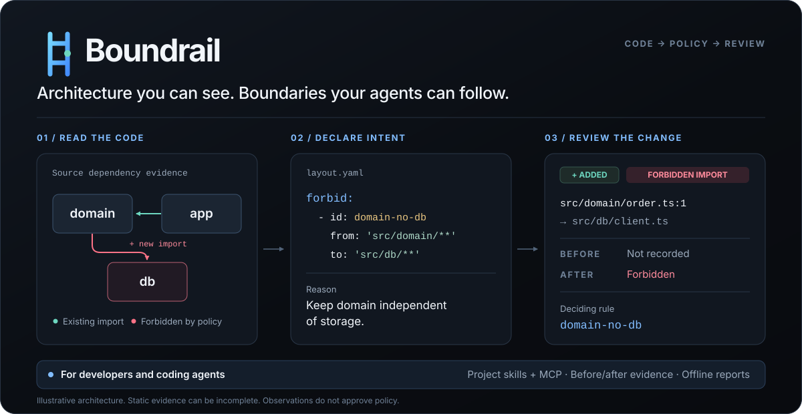
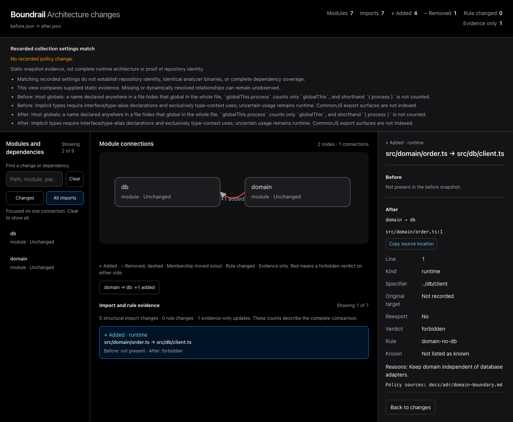
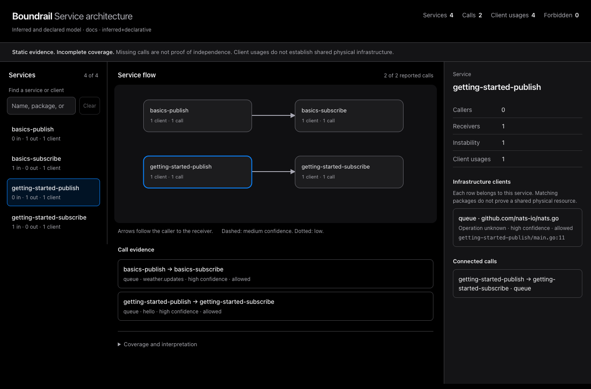

# Boundrail

**Architecture your agents can follow.**

Boundrail maps the relationships in your code, checks the boundaries you declare, and shows what
an edit changes. Use it from the CLI, in CI, or through MCP. Developers and coding agents get the
same source locations, rule reasons, and repeatable checks.

<picture>
  <source media="(max-width: 700px)" srcset="docs/assets/boundrail-overview-mobile.svg">
  
</picture>

[Quickstart](#quickstart) · [Architecture rules](#make-the-boundaries-explicit) · [For coding agents](#give-agents-a-project-workflow) · [Service model](#see-services-and-infrastructure-clients) · [Evidence and limits](#evidence-and-limits) · [Full guide](docs/guide.md)

## Review the architectural change

An import diff should explain the change. Boundrail keeps the old and new evidence together:
added and removed dependencies, module membership, deciding rules, and source locations.



```sh
# Capture the baseline before editing.
mkdir -p .archgraph
boundrail scan . --engine native --symbols --rules layout.yaml -o .archgraph/before.json

# After editing, collect with the same options and review the change.
boundrail scan . --engine native --symbols --rules layout.yaml -o .archgraph/after.json
boundrail diff .archgraph/before.json .archgraph/after.json --html changes.html --fail-on new-forbidden
```

Open `changes.html` to inspect the comparison. Removed imports remain selectable. A moved line is
labelled **Evidence only**. Policy changes have their own notice, and missing collection metadata
produces an **Unverified comparison**. A failing gate still writes the HTML for review.

The screenshot comes from a native scan before and after an actual fixture edit. It is not a
production traffic trace. [Comparison behavior and compatibility](docs/guide.md#visual-architecture-diff).

## What you can do

| Job | What Boundrail provides | Start here |
| --- | --- | --- |
| Understand a codebase | Module and file dependencies, cycles, coupling, public surfaces, and source evidence in an explorable map. | `boundrail report . --engine native` |
| State the intended architecture | Layers, allowed and forbidden imports, public entrypoints, package boundaries, reasons, and ADR references. | [`layout.yaml`](#make-the-boundaries-explicit) |
| Guide an agent | Project-specific skill drafts, budgeted context, ten read-only MCP tools, and per-edit checks. | `boundrail skill draft .` |
| Review a change | Before/after module, import, and rule evidence. New-only gates for imports and service reports. | `boundrail diff before.json after.json --html changes.html` |
| Map an application | Inferred service boundaries, infrastructure client usage, and supported HTTP and queue relationships. | `boundrail services .` |
| Plan and verify a refactor | Import-cut suggestions, move simulations, stable finding IDs, fix recipes, and verification predicates. | [`propose`, `apply`, and `verify`](docs/guide.md#fix-recipes-and-verification) |
| Find the affected code | Reverse dependencies, candidate tests and reviewers, CODEOWNERS, churn, and historical evidence. | `boundrail impact origin/main..HEAD` |

## Quickstart

Build the checked-out source with stable Rust:

```sh
git clone https://github.com/dogebonker/archgraph.git
cd archgraph
cargo +stable install --path . --locked --bin boundrail

boundrail report /path/to/your/project --engine native
```

`report` prints a summary and writes a JSON document and an offline HTML map in `.archgraph/`.
Open the HTML file in your browser. The native engine is experimental. Go import collection still
uses the Go toolchain for read-only package metadata.
Run the remaining examples from your project's root directory.

Boundrail was previously named **Archgraph**. The repository URL and `.archgraph/` project state
retain their existing names for compatibility. [Upgrade notes](docs/rename-boundrail.md) ·
[Installation and collector requirements](docs/guide.md#install).

<a href="https://dogebonker.github.io/archgraph/next.js.html">
  
</a>

*Explore the [Next.js map](https://dogebonker.github.io/archgraph/next.js.html) or the
[public-repository gallery](showcase/). This earlier capture uses the Archgraph name.*

The map supports zoom, module selection, remembered positions, and a file-level view. Its
**What-if** mode previews file moves without changing source. Rust simulations and the project's
build and tests remain the checks for an actual refactor.

## Make the boundaries explicit

The graph describes observed dependencies. Your policy describes which dependencies are allowed.
Put the agreed constraints in `layout.yaml`:

```yaml
version: 1
layers:
  - src/domain/**
  - src/application/**
  - src/adapters/**
  - src/main.ts
forbid:
  - id: domain-no-adapters
    from: src/domain/**
    to: src/adapters/**
    reason: Keep domain logic independent of I/O adapters.
public:
  - module: src/orders/**
    entries: [src/orders/index.ts]
```

```sh
boundrail check . --rules layout.yaml
```

Rules can also constrain external packages and indirect reachability. Named claims retain their
reasons and ADR sources. Inferred layouts and the five architecture presets help you draft policy,
but observed dependency direction does not automatically become intended architecture.
[Rule syntax, precedence, and examples](docs/guide.md#rules-file) ·
[ADR import and lifecycle checks](docs/guide.md#adr-import-and-lifecycle-checks).

## Give agents a project workflow

Analyze the repository into an inactive skill draft:

```sh
boundrail skill draft .
```

Review `.archgraph/drafts/project-architecture/SKILL.md` and its policy references. With a reviewed
root `layout.yaml` in place, regenerate the draft and adopt it:

```sh
boundrail skill draft .
boundrail skill adopt .
```

Adoption installs `.agents/skills/project-architecture/SKILL.md`. It verifies policy fingerprints
and preserves notes outside the generated block. Drafting never changes active policy or source.
When no layout exists, the proposal stays in the draft directory until you review it.
[Draft, review, adopt, and update](docs/guide.md#project-architecture-skill).

### Check edits as they happen

```sh
boundrail hook install --agent codex
boundrail serve . --engine native --symbols
```

Keep the daemon running and start the agent in another terminal. Claude Code and Codex receive
bounded context before edits and checks for new violations afterwards. Existing findings remain
advisory. Codex requires explicit hook trust through `/hooks`. Cursor and OpenCode use
`--feedback-only`. [Host contracts, recovery, and the scripted demo](docs/agents/loop.md).


### Connect through MCP

```sh
claude mcp add --transport stdio boundrail -- boundrail mcp . --engine native --symbols
```

The ten read-only tools cover context selection, relevant rules, explanations, target claims,
change checks, PR review, service evidence, fix proposals, move simulation, and verification.
Answers have explicit budgets, omissions, and unavailable states.
[Claude Code, Cursor, and Codex configurations](docs/guide.md#mcp-server).

Five bundled skills cover general architecture analysis, context, regression checks, fixes, and
policy drafting. They complement the generated project skill:
[`boundrail`](skills/boundrail/SKILL.md),
[`boundrail-context`](skills/boundrail-context/SKILL.md),
[`boundrail-guard`](skills/boundrail-guard/SKILL.md),
[`boundrail-fix`](skills/boundrail-fix/SKILL.md), and
[`boundrail-rules`](skills/boundrail-rules/SKILL.md).

<details>
<summary>Install the bundled skills from a source checkout</summary>

For Codex, copy the five folders together so their sibling links and scripts remain available:

```sh
mkdir -p "${CODEX_HOME:-$HOME/.codex}/skills"
cp -R skills/boundrail* "${CODEX_HOME:-$HOME/.codex}/skills/"
```

Keep local customizations before copying updates. For a project install or another agent client,
use that client's skill directory. Installing skills does not install the binary or enable hooks.

</details>

## See services and infrastructure clients

Infer a source-based application model without adopting an application SDK or running the application:

```sh
boundrail services . --format json -o services-report.json
boundrail render services-report.json -o services.html
```



*A NATS reference model with explicit service boundaries. This is static relationship evidence,
not observed runtime traffic.*

The offline catalog shows services, directed calls, owned client usages, confidence, and source
locations. Supported patterns cover database and cache clients, HTTP calls, queue publishers and
consumers, and routes. Configuration, wrappers, dynamic values, and unsupported transports can
hide genuine relationships.

A `services.yaml` manifest can override service boundaries, declare relationships such as gRPC,
and forbid service calls or explicit infrastructure package usage:

```yaml
version: 1
services: [api, worker]
edges: []
forbid:
  - id: worker-no-postgres
    from: worker
    to: pkg:pg
    reason: Database access belongs to the API.
```

```sh
# Check every observed violation against authored service rules.
boundrail services . --manifest services.yaml --fail-on-forbidden

# Or compare two saved reports and fail only on newly observed violations.
boundrail diff services-before.json services-after.json --fail-on new-forbidden
```

Both service evidence sets use the later report's rules. Policy changes are reported separately.
Client usage does not establish physical database ownership, and a missing edge does not prove
independence. [Service rules, inference limits, and report behavior](docs/guide.md#service-architecture).

## Language and engine coverage

| Source language | Import graph and architecture rules | Native service and client evidence |
| --- | --- | --- |
| TypeScript and JavaScript | Yes | Supported HTTP, database, cache, and queue patterns |
| Python | Yes | FastAPI, Flask, requests, httpx, and named Celery tasks |
| Go | Yes | Supported net/http, database, cache, and NATS patterns |
| Rust, Java, and Elixir | Yes | Client and call inference unavailable |

Import analysis offers reference collectors and an experimental native engine. Their coverage and
tool requirements differ. Rust relationships describe source coupling, and Elixir macros and
dynamic references can hide dependencies. Reference TypeScript collection can execute a
repository-selected tool through npx, so use trusted code or a sandbox.
[Engine selection and limits](docs/guide.md#native-engine).

## More ways to inspect the code

| Question | Command or guide |
| --- | --- |
| What should an agent read for this task? | [`context`](docs/guide.md#context-pruning) selects files, rules, and available symbols within a budget. |
| Which modules, tests, and reviewers can this change affect? | [`impact`](docs/guide.md#impact) follows reverse imports and records uncertainty. |
| Which exports are used outside their module? | [`surface`](docs/guide.md#public-surface) reports observed consumers and declared entrypoint bypasses. |
| Which change might untangle this cycle? | [`propose` and `simulate`](docs/guide.md#fix-recipes-and-verification) provide source-backed candidates and expected deltas. |
| Could this folder become a package? | [`package-splits`](docs/guide.md#package-splits) checks existing workspaces and simulates candidate boundaries. |
| Where did this finding begin? | [`bisect`, ownership, and hotspots](docs/guide.md#ownership) connect dependency evidence with recorded history. |
| How has the architecture changed? | [`history`](docs/guide.md#history) retains snapshots, drift metrics, and failed-collection notices. |
| How do I gate a pull request? | [GitHub Action and CI setup](docs/guide.md#ci) apply architecture checks to a baseline. |

## Evidence and limits

Boundrail provides repeatable checks and inspectable evidence. We do not claim that it has
proven faster agents, complete architecture discovery, or semantic correctness.

| Evaluation | What the recorded evidence shows |
| --- | --- |
| Public-repository agent tasks | No architecture or completion benefit demonstrated in the small controlled trials. Guarded runs added overhead, and failures remain in the record. [Runs and costs](bench/results/README.md) · [Boundary challenge](bench/results/usefulness-2026-10-20-fixed-harness/README.md). |
| Budgeted reading context | Mixed results on 30 PRs. Some export-only hits improved file coverage without improving full-body recall. [Protocol and per-PR results](benchmarks/CONTEXT.md). |
| Service-flow inference | 3 of 11 frozen source-labelled flows recovered. All three are NATS reference flows. The eight application HTTP flows remain misses. This is not a runtime or whole-repository precision result. [Labels, controls, and reproduction](benchmarks/SERVICE_FLOWS.md). |
| Edit-loop responsiveness | A 2,000-file fixture met the measured warm/cold targets. Repository-specific latency varies. [Samples, machine details, and limits](docs/agents/loop.md). |

Reports show **at least these relationships** within the collected scope. Folder grouping can
misrepresent deployment or ownership boundaries. Inferred suggestions require review, missing
provenance stays visible, and semantic changes still need the project's build and tests.

Historical screenshots, measurements, and transcripts retain the name used when they were captured.
[Full command guide](docs/guide.md) · [Changelog](CHANGELOG.md) · [Third-party notices](THIRD_PARTY_NOTICES.md).

## License

MIT or Apache-2.0, at your option.
