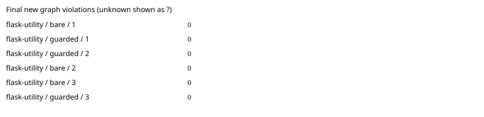

# flask: paired agent benchmark

Commit `75526f46658521d279c2a493b14097898a6a6582`; model `gpt-6.1-sol`; 3 repetitions.
Architecture package: `automatic selection`.

All runs are included. Unknown measurements are `?`; failed runs remain visible.

| Task | Arm | Run | New violations | Edit blocks | Applied recipes | Raw receipt files | Hook activation | Eligible | Expected area touched | Tests | Tokens | Agent seconds | Diff lines | Errors |
|---|---|---:|---:|---:|---:|---:|---|---|---|---|---:|---:|---:|---|
| flask-utility | bare | 1 | 0 | 0 | 0 | 0 | verified_absent | True | True | True | 59718 | 15.511 | 2 | none |
| flask-utility | guarded | 1 | 0 | 0 | 0 | 0 | verified_active | True | True | True | 62029 | 19.867 | 4 | none |
| flask-utility | guarded | 2 | 0 | 0 | 0 | 0 | verified_active | True | True | True | 136821 | 34.215 | 18 | none |
| flask-utility | bare | 2 | 0 | 0 | 0 | 0 | verified_absent | True | True | True | 59757 | 13.337 | 2 | none |
| flask-utility | bare | 3 | 0 | 0 | 0 | 0 | verified_absent | True | True | True | 76369 | 16.697 | 2 | none |
| flask-utility | guarded | 3 | 0 | 0 | 0 | 0 | verified_active | True | True | True | 70308 | 22.269 | 2 | none |

Means ± sample standard deviation (comparison-eligible runs only; all other runs remain in the table):

- bare: new_violations: 0 ± 0.0 (n=3); edit_blocks: 0 ± 0.0 (n=3); recipes_applied: 0 ± 0.0 (n=3); wall_seconds: 15.181749985980181 ± 1.7039871336272816 (n=3); failed runs=0.
- guarded: new_violations: 0 ± 0.0 (n=3); edit_blocks: 0 ± 0.0 (n=3); recipes_applied: 0 ± 0.0 (n=3); wall_seconds: 25.450437319697812 ± 7.684905937530648 (n=3); failed runs=0.

Repeat variance by task (not pooled across different tasks):

| Task | Arm | Measured | Mean new violations | Sample SD |
|---|---|---:|---:|---:|
| flask-utility | bare | 3 | 0 | 0.0 |
| flask-utility | guarded | 3 | 0 | 0.0 |

[Raw measurements, command output and provenance](flask-2026-10-19.json).

Guarded activation requires the reviewed app-server protocol and correlated native notifications; installation is insufficient. Unknown activation and policy mutations are excluded from efficacy means. Tokens are nullable terminal usage counters; applied recipes require Rust receipt/current-source verification. Graph counts are new forbidden edges plus new/grown cycles against the original commit. Synthetic/mock results establish harness behavior only. Isolation overrides and missing seed support are recorded per run. Review the raw command output to verify host hook trust.
