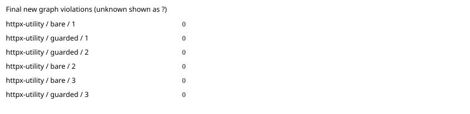

# httpx: paired agent benchmark

Commit `c8b9965eaca60a175c38c89634be7e30bc792b6c`; model `gpt-6.1-sol`; 3 repetitions.
Architecture package: `automatic selection`.

All runs are included. Unknown measurements are `?`; failed runs remain visible.

| Task | Arm | Run | New violations | Edit blocks | Applied recipes | Raw receipt files | Hook activation | Eligible | Expected area touched | Tests | Tokens | Agent seconds | Diff lines | Errors |
|---|---|---:|---:|---:|---:|---:|---|---|---|---|---:|---:|---:|---|
| httpx-utility | bare | 1 | 0 | 0 | 0 | 0 | verified_absent | True | True | True | 63202 | 15.134 | 8 | none |
| httpx-utility | guarded | 1 | 0 | 0 | 0 | 0 | verified_active | True | True | True | 155557 | 36.204 | 20 | none |
| httpx-utility | guarded | 2 | 0 | 0 | 0 | 0 | verified_active | True | True | True | 81141 | 23.81 | 4 | none |
| httpx-utility | bare | 2 | 0 | 0 | 0 | 0 | verified_absent | True | True | True | 61495 | 14.75 | 4 | none |
| httpx-utility | bare | 3 | 0 | 0 | 0 | 0 | verified_absent | True | True | True | 65822 | 14.728 | 4 | none |
| httpx-utility | guarded | 3 | 0 | 0 | 0 | 0 | verified_active | True | True | True | 69721 | 17.032 | 4 | none |

Means ± sample standard deviation (comparison-eligible runs only; all other runs remain in the table):

- bare: new_violations: 0 ± 0.0 (n=3); edit_blocks: 0 ± 0.0 (n=3); recipes_applied: 0 ± 0.0 (n=3); wall_seconds: 14.870612097360814 ± 0.22848678655396099 (n=3); failed runs=0.
- guarded: new_violations: 0 ± 0.0 (n=3); edit_blocks: 0 ± 0.0 (n=3); recipes_applied: 0 ± 0.0 (n=3); wall_seconds: 25.68191031929261 ± 9.72238107057153 (n=3); failed runs=0.

Repeat variance by task (not pooled across different tasks):

| Task | Arm | Measured | Mean new violations | Sample SD |
|---|---|---:|---:|---:|
| httpx-utility | bare | 3 | 0 | 0.0 |
| httpx-utility | guarded | 3 | 0 | 0.0 |

[Raw measurements, command output and provenance](httpx-2026-10-19.json).

Guarded activation requires the reviewed app-server protocol and correlated native notifications; installation is insufficient. Unknown activation and policy mutations are excluded from efficacy means. Tokens are nullable terminal usage counters; applied recipes require Rust receipt/current-source verification. Graph counts are new forbidden edges plus new/grown cycles against the original commit. Synthetic/mock results establish harness behavior only. Isolation overrides and missing seed support are recorded per run. Review the raw command output to verify host hook trust.
