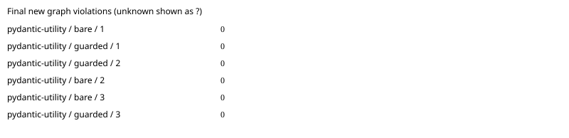

# pydantic: paired agent benchmark

Commit `e6b41881927425ef7eeaf1e43624f3f760e14a7a`; model `gpt-6.1-sol`; 3 repetitions.
Architecture package: `pydantic`.

All runs are included. Unknown measurements are `?`; failed runs remain visible.

| Task | Arm | Run | New violations | Edit blocks | Applied recipes | Raw receipt files | Hook activation | Eligible | Expected area touched | Tests | Tokens | Agent seconds | Diff lines | Errors |
|---|---|---:|---:|---:|---:|---:|---|---|---|---|---:|---:|---:|---|
| pydantic-utility | bare | 1 | 0 | 0 | 0 | 0 | verified_absent | True | True | True | 92620 | 17.699 | 11 | none |
| pydantic-utility | guarded | 1 | 0 | 0 | 0 | 0 | unknown | False | False | False | 86676 | 14.4 | 0 | expected touched area unchanged; feature work unverified; project tests failed |
| pydantic-utility | guarded | 2 | 0 | 0 | 0 | 0 | unknown | False | False | False | 75449 | 16.513 | 0 | expected touched area unchanged; feature work unverified; project tests failed |
| pydantic-utility | bare | 2 | 0 | 0 | 0 | 0 | verified_absent | True | True | True | 90487 | 19.528 | 10 | none |
| pydantic-utility | bare | 3 | 0 | 0 | 0 | 0 | verified_absent | True | True | True | 89221 | 18.954 | 11 | none |
| pydantic-utility | guarded | 3 | 0 | 0 | 0 | 0 | unknown | False | False | False | 61428 | 16.34 | 0 | expected touched area unchanged; feature work unverified; project tests failed |

Means ± sample standard deviation (comparison-eligible runs only; all other runs remain in the table):

- bare: new_violations: 0 ± 0.0 (n=3); edit_blocks: 0 ± 0.0 (n=3); recipes_applied: 0 ± 0.0 (n=3); wall_seconds: 18.72695674964537 ± 0.9349975014294569 (n=3); failed runs=0.
- guarded: new_violations: ? ± ? (n=0); edit_blocks: ? ± ? (n=0); recipes_applied: ? ± ? (n=0); wall_seconds: ? ± ? (n=0); failed runs=3.

Repeat variance by task (not pooled across different tasks):

| Task | Arm | Measured | Mean new violations | Sample SD |
|---|---|---:|---:|---:|
| pydantic-utility | bare | 3 | 0 | 0.0 |
| pydantic-utility | guarded | 0 | ? | ? |

[Raw measurements, command output and provenance](pydantic-2026-10-19.json).

Guarded activation requires the reviewed app-server protocol and correlated native notifications; installation is insufficient. Unknown activation and policy mutations are excluded from efficacy means. Tokens are nullable terminal usage counters; applied recipes require Rust receipt/current-source verification. Graph counts are new forbidden edges plus new/grown cycles against the original commit. Synthetic/mock results establish harness behavior only. Isolation overrides and missing seed support are recorded per run. Review the raw command output to verify host hook trust.
