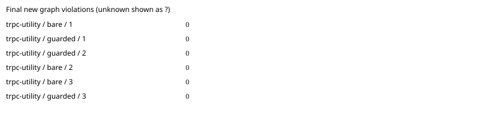

# trpc: paired agent benchmark

Commit `44cbb4e7e6ed6deb68efd336dcb149e750430598`; model `gpt-6.1-sol`; 3 repetitions.
Architecture package: `automatic selection`.

All runs are included. Unknown measurements are `?`; failed runs remain visible.

| Task | Arm | Run | New violations | Edit blocks | Applied recipes | Raw receipt files | Hook activation | Eligible | Expected area touched | Tests | Tokens | Agent seconds | Diff lines | Errors |
|---|---|---:|---:|---:|---:|---:|---|---|---|---|---:|---:|---:|---|
| trpc-utility | bare | 1 | 0 | 0 | 0 | 0 | verified_absent | True | True | True | 79043 | 19.865 | 5 | none |
| trpc-utility | guarded | 1 | 0 | 0 | 0 | 0 | verified_active | True | True | True | 178603 | 85.359 | 5 | none |
| trpc-utility | guarded | 2 | 0 | 0 | 0 | 0 | unknown | False | True | True | 441594 | 137.762 | 5 | none |
| trpc-utility | bare | 2 | 0 | 0 | 0 | 0 | verified_absent | True | True | True | 78420 | 22.276 | 5 | none |
| trpc-utility | bare | 3 | 0 | 0 | 0 | 0 | verified_absent | True | True | True | 63952 | 18.057 | 5 | none |
| trpc-utility | guarded | 3 | 0 | 0 | 0 | 0 | verified_active | True | True | True | 170055 | 73.31 | 5 | none |

Means ± sample standard deviation (comparison-eligible runs only; all other runs remain in the table):

- bare: new_violations: 0 ± 0.0 (n=3); edit_blocks: 0 ± 0.0 (n=3); recipes_applied: 0 ± 0.0 (n=3); wall_seconds: 20.066056708300795 ± 2.1169632691175346 (n=3); failed runs=0.
- guarded: new_violations: 0 ± 0.0 (n=2); edit_blocks: 0 ± 0.0 (n=2); recipes_applied: 0 ± 0.0 (n=2); wall_seconds: 79.33478995849146 ± 8.520189467520359 (n=2); failed runs=0.

Repeat variance by task (not pooled across different tasks):

| Task | Arm | Measured | Mean new violations | Sample SD |
|---|---|---:|---:|---:|
| trpc-utility | bare | 3 | 0 | 0.0 |
| trpc-utility | guarded | 2 | 0 | 0.0 |

[Raw measurements, command output and provenance](trpc-2026-10-19.json).

Guarded activation requires the reviewed app-server protocol and correlated native notifications; installation is insufficient. Unknown activation and policy mutations are excluded from efficacy means. Tokens are nullable terminal usage counters; applied recipes require Rust receipt/current-source verification. Graph counts are new forbidden edges plus new/grown cycles against the original commit. Synthetic/mock results establish harness behavior only. Isolation overrides and missing seed support are recorded per run. Review the raw command output to verify host hook trust.
