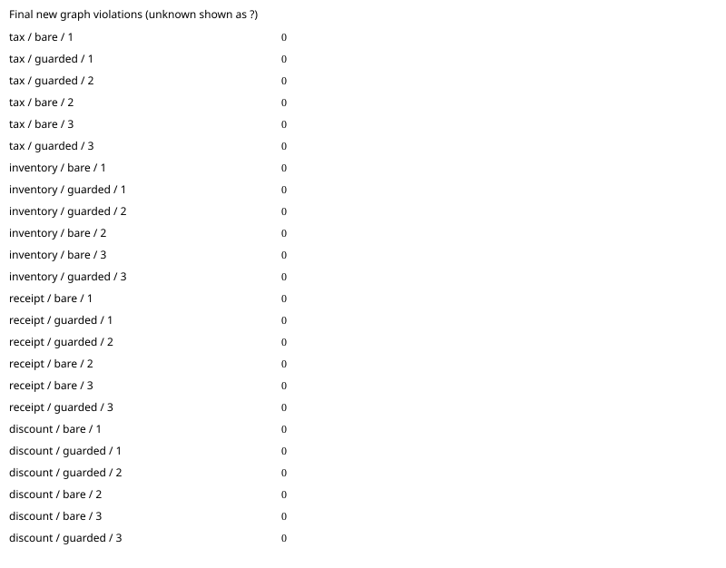

# baseline: paired agent benchmark

Commit `91d430866db63aa0177506861fb311d9ed8f4bbe`; model `gpt-6.1-sol`; 3 repetitions.
Architecture package: `shop`.

All runs are included. Unknown measurements are `?`; failed runs remain visible.

| Task | Arm | Run | New violations | Edit blocks | Applied recipes | Raw receipt files | Hook activation | Eligible | Expected area touched | Tests | Tokens | Agent seconds | Diff lines | Errors |
|---|---|---:|---:|---:|---:|---:|---|---|---|---|---:|---:|---:|---|
| tax | bare | 1 | 0 | 0 | 0 | 0 | verified_absent | True | True | True | 77610 | 22.281 | 15 | none |
| tax | guarded | 1 | 0 | 0 | 0 | 0 | verified_active | True | True | True | 162429 | 34.522 | 7 | none |
| tax | guarded | 2 | 0 | 0 | 0 | 0 | verified_active | True | True | True | 162614 | 31.32 | 7 | none |
| tax | bare | 2 | 0 | 0 | 0 | 0 | verified_absent | True | True | True | 78917 | 23.879 | 14 | none |
| tax | bare | 3 | 0 | 0 | 0 | 0 | verified_absent | True | True | True | 78227 | 24.326 | 14 | none |
| tax | guarded | 3 | 0 | 0 | 0 | 0 | verified_active | True | True | True | 124602 | 31.635 | 13 | none |
| inventory | bare | 1 | 0 | 0 | 0 | 0 | verified_absent | True | True | True | 76566 | 21.263 | 9 | none |
| inventory | guarded | 1 | 0 | 0 | 0 | 0 | verified_active | True | True | True | 126144 | 33.392 | 9 | none |
| inventory | guarded | 2 | 0 | 0 | 0 | 0 | verified_active | True | True | True | 123464 | 34.261 | 9 | none |
| inventory | bare | 2 | 0 | 0 | 0 | 0 | verified_absent | True | True | True | 76266 | 14.523 | 9 | none |
| inventory | bare | 3 | 0 | 0 | 0 | 0 | verified_absent | True | True | True | 76605 | 15.391 | 9 | none |
| inventory | guarded | 3 | 0 | 0 | 0 | 0 | verified_active | True | True | True | 164492 | 36.38 | 9 | none |
| receipt | bare | 1 | 0 | 0 | 0 | 0 | verified_absent | True | True | True | 77000 | 22.85 | 10 | none |
| receipt | guarded | 1 | 0 | 0 | 0 | 0 | verified_active | True | True | True | 144567 | 45.841 | 19 | none |
| receipt | guarded | 2 | 0 | 0 | 0 | 0 | verified_active | True | True | True | 104843 | 29.066 | 10 | none |
| receipt | bare | 2 | 0 | 0 | 0 | 0 | verified_absent | True | True | True | 76333 | 17.352 | 4 | none |
| receipt | bare | 3 | 0 | 0 | 0 | 0 | verified_absent | True | True | True | 60497 | 13.891 | 6 | none |
| receipt | guarded | 3 | 0 | 0 | 0 | 0 | verified_active | True | True | True | 145636 | 39.789 | 9 | none |
| discount | bare | 1 | 0 | 0 | 0 | 0 | verified_absent | True | True | True | 60396 | 16.327 | 9 | none |
| discount | guarded | 1 | 0 | 0 | 0 | 0 | verified_active | True | True | True | 120696 | 37.364 | 9 | none |
| discount | guarded | 2 | 0 | 0 | 0 | 0 | verified_active | True | True | True | 120545 | 34.404 | 8 | none |
| discount | bare | 2 | 0 | 0 | 0 | 0 | verified_absent | True | True | True | 60368 | 14.705 | 10 | none |
| discount | bare | 3 | 0 | 0 | 0 | 0 | verified_absent | True | True | True | 59841 | 14.959 | 8 | none |
| discount | guarded | 3 | 0 | 0 | 0 | 0 | verified_active | True | True | True | 140030 | 32.566 | 8 | none |

Means ± sample standard deviation (comparison-eligible runs only; all other runs remain in the table):

- bare: new_violations: 0 ± 0.0 (n=12); edit_blocks: 0 ± 0.0 (n=12); recipes_applied: 0 ± 0.0 (n=12); wall_seconds: 18.47897920826411 ± 4.083536513375478 (n=12); failed runs=0.
- guarded: new_violations: 0 ± 0.0 (n=12); edit_blocks: 0 ± 0.0 (n=12); recipes_applied: 0 ± 0.0 (n=12); wall_seconds: 35.044923993060365 ± 4.448064108459833 (n=12); failed runs=0.

Repeat variance by task (not pooled across different tasks):

| Task | Arm | Measured | Mean new violations | Sample SD |
|---|---|---:|---:|---:|
| tax | bare | 3 | 0 | 0.0 |
| tax | guarded | 3 | 0 | 0.0 |
| inventory | bare | 3 | 0 | 0.0 |
| inventory | guarded | 3 | 0 | 0.0 |
| receipt | bare | 3 | 0 | 0.0 |
| receipt | guarded | 3 | 0 | 0.0 |
| discount | bare | 3 | 0 | 0.0 |
| discount | guarded | 3 | 0 | 0.0 |

[Raw measurements, command output and provenance](baseline-2026-10-19.json).

Guarded activation requires the reviewed app-server protocol and correlated native notifications; installation is insufficient. Unknown activation and policy mutations are excluded from efficacy means. Tokens are nullable terminal usage counters; applied recipes require Rust receipt/current-source verification. Graph counts are new forbidden edges plus new/grown cycles against the original commit. Synthetic/mock results establish harness behavior only. Isolation overrides and missing seed support are recorded per run. Review the raw command output to verify host hook trust.
