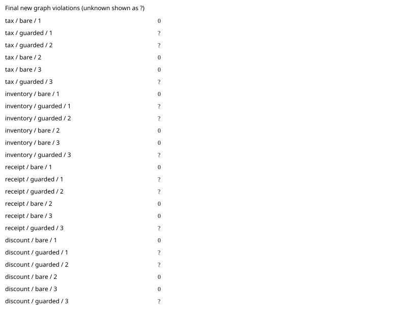

# baseline: paired agent benchmark

Commit `91d430866db63aa0177506861fb311d9ed8f4bbe`; model `gpt-6.1-sol`; 3 repetitions.
Architecture package: `shop`.

All runs are included. Unknown measurements are `?`; failed runs remain visible.

| Task | Arm | Run | New violations | Edit blocks | Applied recipes | Raw receipt files | Hook activation | Eligible | Expected area touched | Tests | Tokens | Agent seconds | Diff lines | Errors |
|---|---|---:|---:|---:|---:|---:|---|---|---|---|---:|---:|---:|---|
| tax | bare | 1 | 0 | 0 | 0 | 0 | verified_absent | True | True | True | 77338 | 21.242 | 10 | none |
| tax | guarded | 1 | ? | ? | ? | ? | ? | False | ? | ? | ? | ? | ? | ['git', 'add', '-A', '--', '.', ':!.archgraph']: The following paths are ignored by one of your .gitignore files: .archgraph hint: Use -f if you really want to add them. hint: Disable this message with "git config set advice.addIgnoredFile false"  |
| tax | guarded | 2 | ? | ? | ? | ? | ? | False | ? | ? | ? | ? | ? | ['git', 'add', '-A', '--', '.', ':!.archgraph']: The following paths are ignored by one of your .gitignore files: .archgraph hint: Use -f if you really want to add them. hint: Disable this message with "git config set advice.addIgnoredFile false"  |
| tax | bare | 2 | 0 | 0 | 0 | 0 | verified_absent | True | True | True | 77100 | 18.251 | 11 | none |
| tax | bare | 3 | 0 | 0 | 0 | 0 | verified_absent | True | True | True | 60896 | 16.349 | 13 | none |
| tax | guarded | 3 | ? | ? | ? | ? | ? | False | ? | ? | ? | ? | ? | ['git', 'add', '-A', '--', '.', ':!.archgraph']: The following paths are ignored by one of your .gitignore files: .archgraph hint: Use -f if you really want to add them. hint: Disable this message with "git config set advice.addIgnoredFile false"  |
| inventory | bare | 1 | 0 | 0 | 0 | 0 | verified_absent | True | True | True | 76670 | 18.62 | 9 | none |
| inventory | guarded | 1 | ? | ? | ? | ? | ? | False | ? | ? | ? | ? | ? | ['git', 'add', '-A', '--', '.', ':!.archgraph']: The following paths are ignored by one of your .gitignore files: .archgraph hint: Use -f if you really want to add them. hint: Disable this message with "git config set advice.addIgnoredFile false"  |
| inventory | guarded | 2 | ? | ? | ? | ? | ? | False | ? | ? | ? | ? | ? | ['git', 'add', '-A', '--', '.', ':!.archgraph']: The following paths are ignored by one of your .gitignore files: .archgraph hint: Use -f if you really want to add them. hint: Disable this message with "git config set advice.addIgnoredFile false"  |
| inventory | bare | 2 | 0 | 0 | 0 | 0 | verified_absent | True | True | True | 76006 | 17.883 | 9 | none |
| inventory | bare | 3 | 0 | 0 | 0 | 0 | verified_absent | True | True | True | 76796 | 14.87 | 9 | none |
| inventory | guarded | 3 | ? | ? | ? | ? | ? | False | ? | ? | ? | ? | ? | ['git', 'add', '-A', '--', '.', ':!.archgraph']: The following paths are ignored by one of your .gitignore files: .archgraph hint: Use -f if you really want to add them. hint: Disable this message with "git config set advice.addIgnoredFile false"  |
| receipt | bare | 1 | 0 | 0 | 0 | 0 | verified_absent | True | True | True | 76694 | 17.584 | 6 | none |
| receipt | guarded | 1 | ? | ? | ? | ? | ? | False | ? | ? | ? | ? | ? | ['git', 'add', '-A', '--', '.', ':!.archgraph']: The following paths are ignored by one of your .gitignore files: .archgraph hint: Use -f if you really want to add them. hint: Disable this message with "git config set advice.addIgnoredFile false"  |
| receipt | guarded | 2 | ? | ? | ? | ? | ? | False | ? | ? | ? | ? | ? | ['git', 'add', '-A', '--', '.', ':!.archgraph']: The following paths are ignored by one of your .gitignore files: .archgraph hint: Use -f if you really want to add them. hint: Disable this message with "git config set advice.addIgnoredFile false"  |
| receipt | bare | 2 | 0 | 0 | 0 | 0 | verified_absent | True | True | True | 76574 | 18.718 | 5 | none |
| receipt | bare | 3 | 0 | 0 | 0 | 0 | verified_absent | True | True | True | 93895 | 24.66 | 10 | none |
| receipt | guarded | 3 | ? | ? | ? | ? | ? | False | ? | ? | ? | ? | ? | ['git', 'add', '-A', '--', '.', ':!.archgraph']: The following paths are ignored by one of your .gitignore files: .archgraph hint: Use -f if you really want to add them. hint: Disable this message with "git config set advice.addIgnoredFile false"  |
| discount | bare | 1 | 0 | 0 | 0 | 0 | verified_absent | True | True | True | 76184 | 15.26 | 9 | none |
| discount | guarded | 1 | ? | ? | ? | ? | ? | False | ? | ? | ? | ? | ? | ['git', 'add', '-A', '--', '.', ':!.archgraph']: The following paths are ignored by one of your .gitignore files: .archgraph hint: Use -f if you really want to add them. hint: Disable this message with "git config set advice.addIgnoredFile false"  |
| discount | guarded | 2 | ? | ? | ? | ? | ? | False | ? | ? | ? | ? | ? | ['git', 'add', '-A', '--', '.', ':!.archgraph']: The following paths are ignored by one of your .gitignore files: .archgraph hint: Use -f if you really want to add them. hint: Disable this message with "git config set advice.addIgnoredFile false"  |
| discount | bare | 2 | 0 | 0 | 0 | 0 | verified_absent | True | True | True | 92164 | 18.323 | 9 | none |
| discount | bare | 3 | 0 | 0 | 0 | 0 | verified_absent | True | True | True | 59675 | 12.436 | 9 | none |
| discount | guarded | 3 | ? | ? | ? | ? | ? | False | ? | ? | ? | ? | ? | ['git', 'add', '-A', '--', '.', ':!.archgraph']: The following paths are ignored by one of your .gitignore files: .archgraph hint: Use -f if you really want to add them. hint: Disable this message with "git config set advice.addIgnoredFile false"  |

Means ± sample standard deviation (comparison-eligible runs only; all other runs remain in the table):

- bare: new_violations: 0 ± 0.0 (n=12); edit_blocks: 0 ± 0.0 (n=12); recipes_applied: 0 ± 0.0 (n=12); wall_seconds: 17.84973232615933 ± 3.1164698433636207 (n=12); failed runs=0.
- guarded: new_violations: ? ± ? (n=0); edit_blocks: ? ± ? (n=0); recipes_applied: ? ± ? (n=0); wall_seconds: ? ± ? (n=0); failed runs=12.

Repeat variance by task (not pooled across different tasks):

| Task | Arm | Measured | Mean new violations | Sample SD |
|---|---|---:|---:|---:|
| tax | bare | 3 | 0 | 0.0 |
| tax | guarded | 0 | ? | ? |
| inventory | bare | 3 | 0 | 0.0 |
| inventory | guarded | 0 | ? | ? |
| receipt | bare | 3 | 0 | 0.0 |
| receipt | guarded | 0 | ? | ? |
| discount | bare | 3 | 0 | 0.0 |
| discount | guarded | 0 | ? | ? |

[Raw measurements, command output and provenance](baseline-2026-10-19.json).

Guarded activation requires the reviewed app-server protocol and correlated native notifications; installation is insufficient. Unknown activation and policy mutations are excluded from efficacy means. Tokens are nullable terminal usage counters; applied recipes require Rust receipt/current-source verification. Graph counts are new forbidden edges plus new/grown cycles against the original commit. Synthetic/mock results establish harness behavior only. Isolation overrides and missing seed support are recorded per run. Review the raw command output to verify host hook trust.
